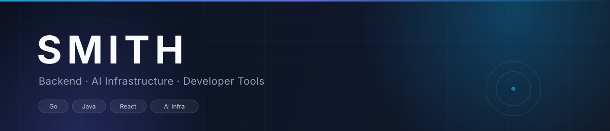

  

 

### 关于

做后端与开发者工具，主要写 **Go / Java / TypeScript**。  
关注 AI API 基础设施、边缘分发和 Agent 产品。

- 正在打磨 **FYT**：AI API 中转与边缘接入
- 同时在做 **Smith Canvas**：面向创作流程的画布工具
- 写点东西：[smithhs.cn](https://smithhs.cn)

### 技术栈

  
  
  
  
  
  
  
  
  
  

### 项目

| 项目 | 说明 |
| :-- | :-- |
| [myproject](https://github.com/Smithhss/myproject) | Java 全栈练习：电商系统 + Spring AI / RAG |
| [shs-shop-parent](https://github.com/Smithhss/shs-shop-parent) | Spring Cloud 微服务电商系统 |
| [smithhs.github.io](https://github.com/Smithhss/smithhs.github.io) | 个人博客与知识库 |
| [smith-theme-static](https://github.com/Smithhss/smith-theme-static) | Hexo 主题静态资源 |

 

  Build quietly, ship often.

